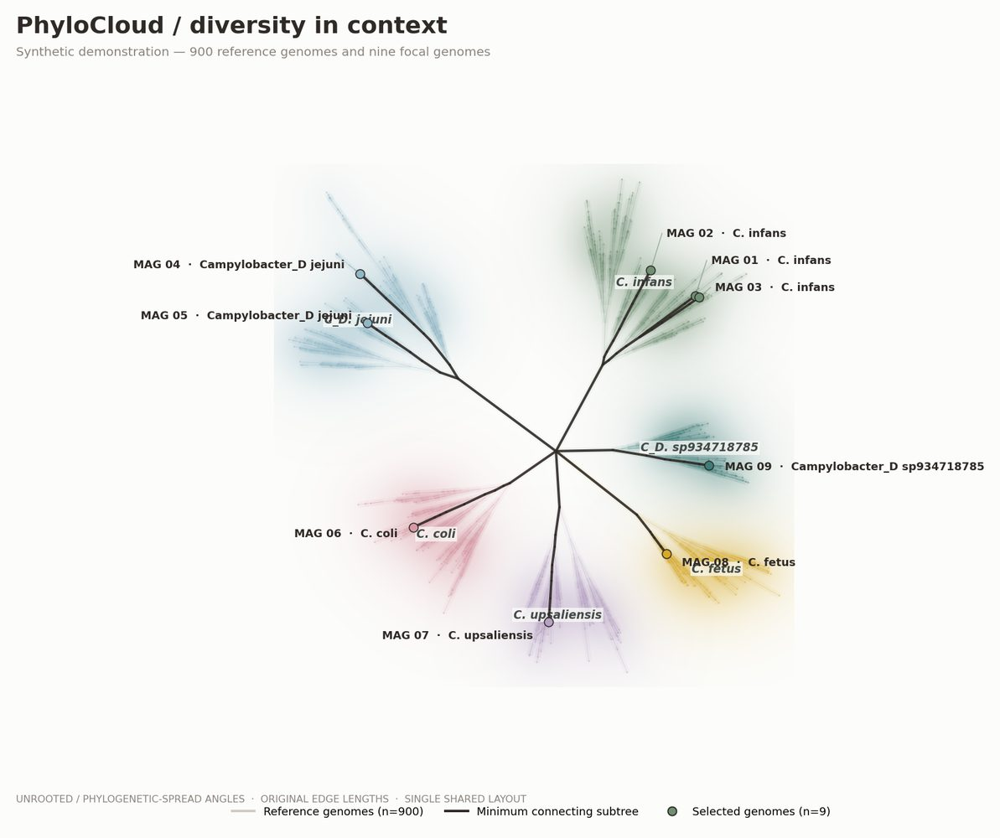

# PhyloCloud

**Beautiful phylogenetic diversity, without changing the tree.**

PhyloCloud is a Python command-line tool for drawing large reference phylogenies as soft, species-coloured **diversity clouds** or fine botanical **canopies**, with the exact connecting branches of selected genomes highlighted in the foreground.

The scientific structure comes from **one original Newick tree and one shared layout**. Reference density is computed from the actual reference tips; it is not a reconstructed phylogeny, a measure of prevalence or a confidence envelope.

| Native **Cloud** · synthetic example | Native **Canopy** · same synthetic tree |
|:---:|:---:|
|  |  |

**Status:** early open-source prototype (v0.3 development). We welcome feedback and contributions. The existing v0.2 `publication` and `soft_cloud` modes remain available; native `cloud` and `canopy` are experimental new modes. [Design](docs/DESIGN_SPEC.md) · [Architecture](docs/ARCHITECTURE.md) · [Roadmap](docs/ROADMAP.md) · [Issues](https://github.com/Benizao1980/PhyloCloud/issues)

## Quick start (about two minutes)

Requires **Python 3.10+**.

```bash
git clone https://github.com/Benizao1980/PhyloCloud.git
cd PhyloCloud
python -m venv .venv
source .venv/bin/activate   # Windows: .venv\Scripts\activate
pip install -e .

# Produce a complete, reproducible synthetic dataset and SVG / PDF / PNG:
phylocloud demo --outdir outputs/demo --style cloud --references 900

# Try the botanical canopy appearance using the same synthetic tree:
phylocloud plot \
  --tree outputs/demo/synthetic_tree.nwk \
  --metadata outputs/demo/synthetic_metadata.tsv \
  --selected outputs/demo/selected_genomes.txt \
  --style canopy \
  --out outputs/demo/canopy
```

The `demo` command uses **fictional genomes**, not private GTDB or GETcampy study data.

## What you get

For an output stem such as `outputs/demo/canopy`:

| File | Contents |
| --- | --- |
| `canopy.svg` | Editable tree branches and text; optional embedded raster density underlay |
| `canopy.pdf` | Publication/export PDF with vector tree and labels |
| `canopy.png` | High-resolution rendered figure |
| `canopy.provenance.json` | Input hashes, tree-edge and branch-length validation, selected counts, density and style settings |

## Use your own phylogeny

Prepare three files:

1. **Tree:** `tree.nwk`, complete Newick with unique tip names and finite, non-negative branch lengths.
2. **Metadata:** `metadata.tsv` (or `.csv`) with exactly matching `genome_id` and `species` columns. Add optional `source`, `label`, `lineage`, `host`, etc.
3. **Selected tips:** `selected.txt`, one exact tree tip ID per line.

Metadata example:

```tsv
genome_id	species	source	label	lineage
REF_01	Campylobacter coli	GTDB		ST-828
REF_02	Campylobacter infans	GTDB		ST-1
MAG_01	Campylobacter coli	MAG	My MAG	ST-828
```

```bash
phylocloud plot \
  --tree tree.nwk --metadata metadata.tsv --selected selected.txt \
  --style cloud --out outputs/my_cloud
```

By default, the new native clouds are coloured and broadly labelled by **species**. To colour and label by a different metadata column:

```bash
phylocloud plot \
  --tree tree.nwk --metadata metadata.tsv --selected selected.txt \
  --style canopy --cloud-group-by lineage --out outputs/by_lineage
```

You can set exact category colours, density resolution, bandwidth and label count in YAML. See the working [Cloud preset](examples/presets/cloud.yml), [Canopy preset](examples/presets/canopy.yml) and [usage guide](docs/USAGE.md).

## Branch-length options

**Original evolutionary branch lengths are preserved by default**, independently of Cloud/Canopy styling. Use `--length-mode original` (default) for a metric phylogram, or `--length-mode graphic` for an **explicitly non-metric**, more expansive layout of the very same tree. Graphic mode changes displayed distances (including expanding zero-length edges) but preserves source topology, edge IDs and original lengths in the model and provenance. See [usage and interpretation](docs/USAGE.md#displayed-branch-lengths-original-vs-graphical-non-metric).

## Visual styles

| Style | Status | Appearance |
| --- | --- | --- |
| `cloud` | **New default for demos** | Soft, metadata-coloured Gaussian washes of reference tip positions with fine original branches |
| `canopy` | **New experimental** | Fine original branching with denser tip dots and foliage-like soft reference colour fields |
| `constellation` | Experimental | Reference tips as luminous points on a dark background |
| `river` | Experimental | Graduated original-branch strokes; **does not** depict gene flow or transmission |
| `publication` | Established | Restrained reference branches and prominent exact connecting subtree |
| `soft_cloud` | Established legacy | Subtle neutral density haze with optional species-tinted branches |

All share the same unrooted tree geometry and exact selected connecting branches. Changing style **must never change phylogenetic relationships or branch lengths**.

## Try a second dataset: synthetic *E. coli* lineages

To demonstrate that PhyloCloud is not Campylobacter-specific, the repository includes a **complete fictional E. coli example**: 180 reference genomes, nine focal isolates and six labelled lineages. The `lineage` metadata column—not species—is selected for the colours and broad labels.

```bash
phylocloud plot \
  --tree examples/other_pathogen/synthetic_tree.nwk \
  --metadata examples/other_pathogen/synthetic_metadata.tsv \
  --selected examples/other_pathogen/selected_genomes.txt \
  --config examples/other_pathogen/config.yml \
  --style cloud --cloud-group-by lineage \
  --detail-selected examples/other_pathogen/detail_selected.txt \
  --out outputs/ecoli_example
```

The command produces an **overview**, an independently editable **detail SVG/PDF**, and a side-by-side comparison PNG. The images below are existing software-generated synthetic Cloud and Canopy demos, not inferred E. coli trees:

| Software-rendered Cloud | Software-rendered Canopy |
|:---:|:---:|
|  |  |

Download reproducible E. coli figure outputs from the [example gallery workflow](.github/workflows/example-gallery.yml) / its GitHub Actions run artifacts, or run the above command locally.

See [the full worked example](examples/other_pathogen/README.md), [actual example exports](examples/outputs/), and [usage details](docs/USAGE.md). The figure is **software-generated from synthetic data**, not a stylised AI rendering or a claim about real E. coli evolution.

## Where to obtain reference genomes

- **[GTDB](https://gtdb.ecogenomic.org/)** — genome taxonomy, reference-genome accessions and downloadable representative sequences. The [GTDB release archive](https://data.gtdb.ecogenomic.org/releases/latest/) also provides `bac120.tree` and `ar53.tree`, but those reference trees do **not automatically include your focal genomes**. Record and match release versions.
- **[NCBI Datasets](https://www.ncbi.nlm.nih.gov/datasets/)** — selected RefSeq/GenBank genome assemblies and metadata; [official genome-download tutorial](https://www.ncbi.nlm.nih.gov/datasets/docs/v2/how-tos/genomes/download-genome/).
- **[ENA](https://www.ebi.ac.uk/ena/browser/home)** and **[BV-BRC](https://www.bv-brc.org/)** — additional sequence/assembly resources.
- **[Kraken2](https://kraken2.readthedocs.io/en/latest/introduction.html)** is a *taxonomic read/sequence classifier*, not a phylogenetic-tree repository. Kraken classifications can be used as metadata; its database or report is **not** a Newick phylogeny with branch lengths.

You will need a combined tree inferred from/including your **reference and focal genomes**, not merely a collection of reference FASTAs or a taxonomic classification report. See our [reference-dataset and tree preparation guide](docs/REFERENCE_DATA.md).

## Automatic species or lineage neighbourhood panels (optional)

To create a **companion preview PNG** containing the complete tree and up to three true-coordinate zooms chosen from metadata:

```bash
phylocloud plot \
  --tree tree.nwk --metadata metadata.tsv --selected selected.txt \
  --style cloud --cloud-group-by species --species-panels 3 \
  --length-mode original --out outputs/my_cloud
```

For an explicitly **non-metric graphical** overview (expanded display lengths, but unchanged original graph and selected edges), replace `--length-mode original` with `--length-mode graphic`. This choice is declared on the output and recorded in provenance. You can group and label panels by `lineage`, `host` or any other supplied metadata category using `--cloud-group-by`.

The additional `my_cloud_species_panels.png` is a raster contact sheet for review, **not** an independently editable SVG/PDF. The standard full-tree SVG/PDF remain editable. Individual neighbourhoods have independently magnified camera crops, not new phylogenetic inferences. Groups with few observed reference genomes are not given fictitious rich reference clouds.

## Neighbourhood magnification (optional)

Add `--detail-selected path/to/subset.txt` to `phylocloud plot` to generate a second, true-coordinate zoom of a **subset of the focal genomes**, plus a convenient side-by-side PNG. The original per-panel SVG/PDF remain editable. No new topology, branch length or genome coordinate is inferred for the detail panel.

## How to interpret the picture

- The colourful background comes from **sampled reference genomes** and original branch coordinates, not simulated populations. Dense patches reflect the input sampling strategy; they do **not** establish natural prevalence.
- A label such as *C. coli* means the reference metadata identify those genomes as that taxon. It does not imply the group is monophyletic; spatially separated species may occupy separate parts of the tree.
- A single or very rare species reference produces little or no visible cloud. A dramatic coloured region should **not** be invented where the reference collection is sparse.
- In an SVG/PDF, the soft density image may be raster, but original tree branches and labels remain vectors. Not every part of a hybrid export is independently editable.
- For heavily imbalanced trees, a **true geometric zoom** is often necessary to inspect dense neighbourhoods at their original scale.

## Documentation and contributing

[Full usage / configuration](docs/USAGE.md) · [Where to get GTDB/NCBI references](docs/REFERENCE_DATA.md) · [Scientific invariants](docs/SCIENTIFIC_INVARIANTS.md) · [Style family](docs/STYLE_FAMILY.md) · [Current v0.2 CLI background](docs/CURRENT_CLI.md) · [Contributing](CONTRIBUTING.md) · [Changelog](CHANGELOG.md).

PhyloCloud is MIT-licensed. See [LICENSE](LICENSE) and [CITATION.cff](CITATION.cff). Developed in the context of the [Campylobacter Control Campaign](https://campylobacter-control-campaign.github.io/website/), but intended for **any organism or pathogen** with an inferred phylogenetic tree and metadata. **Unpublished GETcampy tree and sample data are not included in this public repository.**


### Improved native density (development)

Cloud/Canopy now have a configurable **multiscale** colour-wash engine that combines observed reference genome locations with sampled positions on **original reference-bearing, same-group branches**. Original branches and highlighted MAG edges remain unchanged and are drawn above the raster underlay. Species remains the default grouping; it can be changed with `--cloud-group-by`. Set `cloud.density_engine: legacy` in YAML to compare the older tip-only renderer. This is an alpha visual enhancement, not a claim that the current whole-tree figure matches the style reference or that sampled density estimates ecological abundance. For a strongly imbalanced phylogeny, use the true-coordinate detail panels described in [usage](docs/USAGE.md).
