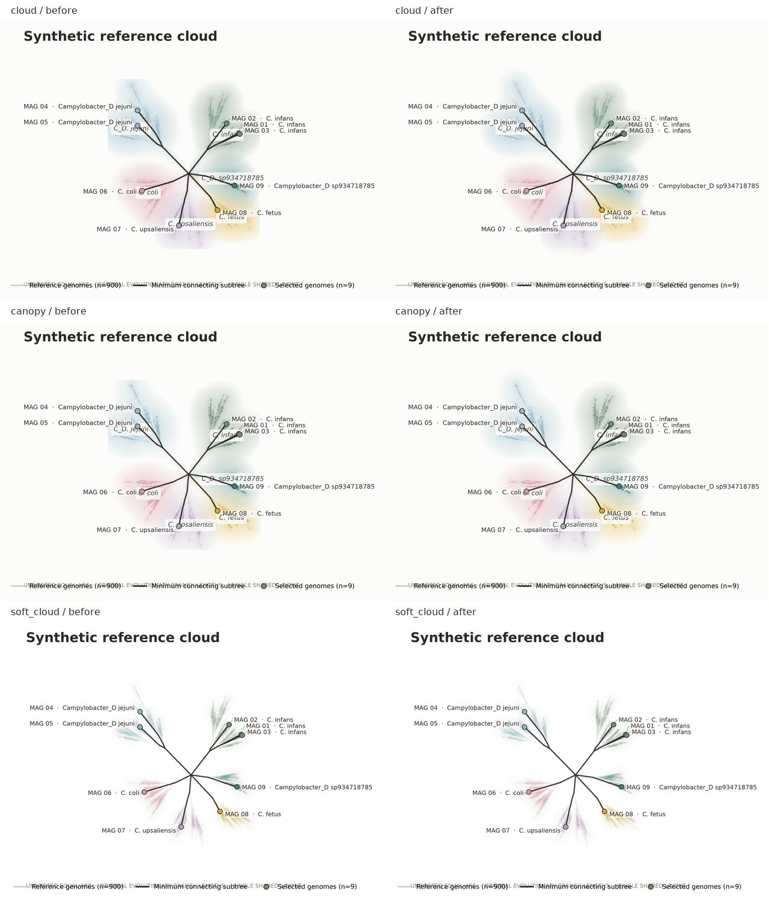

# Reference-cloud raster boundaries

This review follows merged PR #22 (`74b49b65d19c90728df83ddaa6d93c110070363b`).
The previous floating-point density wash could still terminate visibly at its
image rectangle. Cloud, Canopy and the legacy `soft_cloud` overlay now include
empty raster margins spanning six standard deviations of the widest kernel.
Original histogram bounds, bin centres, sampling weights and cell sizes are
retained: the histogram is computed first, then padded. This extends the derived
wash without moving any scientific coordinates or changing density bandwidth.

The separable, normalized sampled Gaussian kernel is truncated at six sigma.
Using a positive sampled kernel also avoids Fourier frequency-cutoff ringing at
subpixel bandwidths. An independent regression agrees with the previous default
kernel in the original image interior to absolute tolerance 1e-9. Allocation
guards reject grids above four million cells or 32 million cells across layers;
these are allocation guards, not a complete peak-memory guarantee.

Full overview cameras include wash pixels with alpha at least 0.001. An explicitly
requested selected-tip crop remains a deliberate geometric crop. Label placement
continues to use the original histogram bounds. The cloud remains a derived
reference-sampling overlay, not prevalence, a confidence region or a claim of
monophyly. No layout algorithm, topology, branch length or foreground selection
algorithm changes are included.

## Synthetic comparison and reproduction



The [compact provenance](../examples/figures/raster-boundary-review.json) records
input/source hashes, configuration, dependencies, original-edge validation,
selected-edge identities, coordinate hash and export hashes. All inputs are
synthetic: seed 47, 900 references and nine selected tips. The comparison uses
the same graph and layout object for each before/after pair. All 1,812 original
edges and 72 selected connecting edges are retained, along with label anchors.

Maximum alpha on the image boundary falls from 0.3422 to zero for Cloud,
0.2674 to zero for Canopy, and 0.03207 to 1.33e-11 for `soft_cloud`.
Synthetic regressions additionally cover zero-length edges, nonmonophyletic
metadata, sparse/outlier lineages, elongated bounds and explicit zooms.

From an installed development checkout, choose a new output directory:

```sh
python scripts/review_raster_boundaries.py --outdir outputs/raster_boundaries_review
python -m pytest -q
```

The script reads the baseline from local Git history and refuses to overwrite
an existing output directory. Full before/after SVG/PDF/PNG and provenance stay
under ignored `outputs/`; only the compact JPEG and summary are committed.
CLI provenance additionally records actual raster extents, pixel padding,
kernel support, visible bounds, camera policy, export settings and file hashes.

## Export checks and remaining limitations

The review exports use 7.1 × 5.5 inch configuration and 300 dpi. SVG retains
editable text and exactly counted vector tree/foreground paths; PDF retains
vector strokes, embedded DejaVu fonts and all nine extractable selected labels.
The density wash is an embedded raster in both formats. Independent PDF checks
used pypdf 6.20.1 locally; this is not a runtime dependency.

Matplotlib's existing tight bounding box gives renderer-dependent physical
extents: Cloud/Canopy SVG width 542.392021 pt versus PDF 542.213708 pt;
PNG is 2281 × 1656 pixels at 300 dpi. The corresponding legacy widths are
540.234927/540.010583 pt and PNG 2252 × 1656. These values are identical before
and after this change within each format; cross-format page dimensions are not
identical. Reproduction requires the recorded dependency/font environment.

The compact review still exposes label collisions and footer/legend overlap at
this figure size. Publication layout needs a separate focused milestone; this
change does not claim automatic publication-ready composition. Existing
anisotropic pixel-space smoothing on elongated bounds is retained. The separate
species-panel PNG helper is outside this main-renderer change. Six-sigma support
is finite; the overview visibility threshold is an optical display policy.
